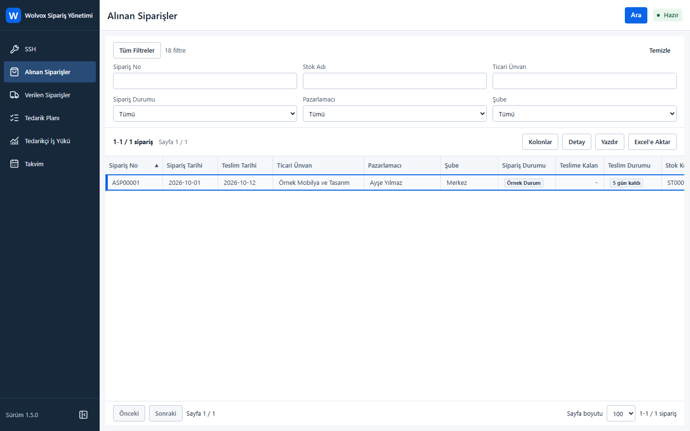
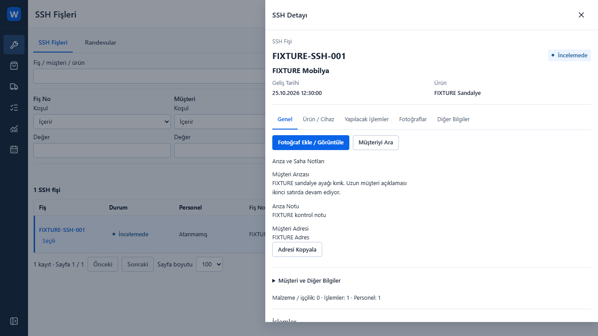
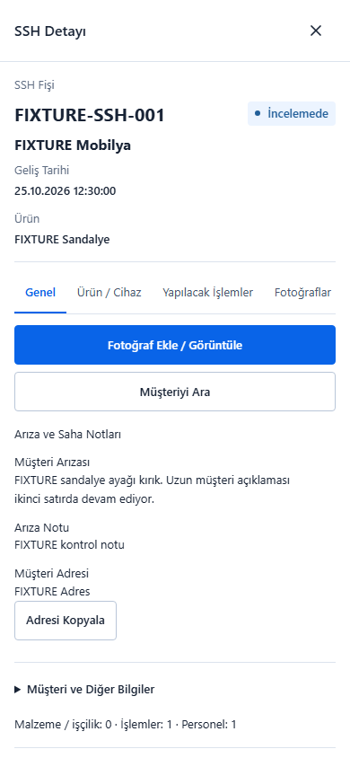

# WolvoxOrderSplit

### ERP-Integrated Order and After-Sales Operations

A responsive web application for teams working with AKINSOFT Wolvox order and service data. WolvoxOrderSplit brings operational lists, record details, procurement planning and optional photographic evidence into one browser-based workspace.

**C# / .NET 10 · ASP.NET Core · React 19 · TypeScript · Firebird · Windows Service**

> Documentation-only portfolio preview. Application source, customer data and deployment packages are not included. The project is at a nonfinal owner-test stage, not a publicly released or production-approved product.

## Business Problem

Order and after-sales teams need to move between customer orders, supplier orders, planning and service records without losing context. Desktop ERP data also needs a usable presentation for field staff on phones, while detailed filters, custom fields and record identity remain intact.

Photographs add another challenge: they must remain associated with the correct business record after a browser reload or device change, without exposing customer information to an untrusted device.

## Solution

WolvoxOrderSplit provides a dense desktop operations console and a mobile-first service detail experience over the existing ERP. The backend remains responsible for data access and authorization; the browser presents the information and permitted actions appropriate to its context.

## Main Capabilities

| Area | Implemented scope | Acceptance boundary |
| --- | --- | --- |
| Order workspaces | Customer and supplier orders, metadata-driven columns, custom-field filters, sorting, paging and record details | Source and fixture regression evidence; customer-specific acceptance remains separate |
| Planning | Procurement plan, supplier workload and operational calendar | Implemented interfaces; no operational adoption or throughput claim |
| Controlled splitting | Split preview, business validation and duplicate-operation safeguards | ERP write acceptance remains a controlled-environment gate, not an unrestricted write capability |
| After-sales service (SSH) | Service list, field-oriented details, customer contact actions and read-only appointments | No appointment creation, editing or conversion workflow is claimed |
| Application photographs | Camera/file selection, durable application storage, previews, captions and logical removal for eligible records | Dataset authorization applies; current installed-host acceptance remains open |
| Appointment photographs | Active appointments support application-archive photos; passive appointments are read-only | Not a native ERP attachment-write feature |
| Native ERP photographs | Read-only display of supported existing JPEG/PNG attachments | Application-to-native attachment writing is blocked pending a verified contract |
| Reporting and access | Export/print workflows, QR device pairing, revocation and configurable external-access modes | Native printing, physical phones and public-network acceptance require their own evidence |

## Application Preview

These are **actual application screenshots captured by Playwright with synthetic test fixtures**, not concept renders. Names, records and addresses shown are test data. The UI is Turkish; this case study is written in English. Browser API fixtures are not proof of a live ERP connection, installed-service operation or physical-device acceptance.

### Order Operations

Metadata-driven order browsing with filters, column selection and reporting actions. This intentionally small fixture contains one order; it is not a usage-volume claim.

### Service Detail Workspace

The selected service remains alongside the list context, with customer fault notes, product information and access to photographic evidence.

### Mobile Field Detail

A 390px layout prioritizes record identity, fault notes, customer contact and the photo entry point rather than compressing the desktop grid.

## Technology Stack

| Layer | Technologies |
| --- | --- |
| Backend | C#, .NET 10, ASP.NET Core, application/domain/infrastructure layers |
| Frontend | React 19, TypeScript, Vite, Tailwind CSS, TanStack Table |
| ERP integration | Firebird, Dapper and the Firebird .NET client |
| Hosting | Customer-hosted Windows Service, HTTPS, optional outbound-tunnel access |
| Photo processing | Restricted image-processing worker and server-side evidence storage |
| Verification | xUnit, API/security integration tests, Vitest, Testing Library, Playwright and axe |

## High-Level Architecture

The responsive browser client communicates with an ASP.NET Core application. The application uses a dedicated integration layer to access the configured ERP dataset. A separate restricted worker processes supported image inputs; application-managed evidence persists on the server rather than in browser storage.

Office and paired-device access share the application, with server-side authorization boundaries. External device access does not grant access to office-only configuration or management operations. Deployment endpoints, credentials, database structures and private implementation details are deliberately omitted here.

## Engineering Challenges

**Preserving ERP capability during UI changes.** Metadata-driven fields, filters and saved column layouts must remain reachable on both desktop and mobile. Behavioral and browser checks help detect capability loss that a screenshot alone would miss.

**Keeping evidence attached to the correct record.** Record-type and dataset boundaries must prevent photographs from appearing under another order or service. Persistence, backup compatibility and logical removal require different tests from a successful file picker interaction.

**Maintaining trust across browser sessions.** Device persistence must coexist with finite expiry, revocation and management denial. A remembered device must not become an indefinite or universal authorization bypass.

**Separating engineering verification from release acceptance.** A passing source test does not prove a restricted worker works under the installed Windows Service account. Likewise, a native attachment reader does not establish safe native writes. Those boundaries are retained rather than hidden behind a release label.

## Development Status

**Active development / nonfinal owner-test candidate prepared.** The latest recorded engineering evidence is dated **26 October 2026**. It includes backend unit/API tests, applicable security tests, frontend checks, selected Chromium regressions and packaging verification. Some environment-specific Windows tests remain deferred; browser fixture checks are not physical-phone tests.

Current installed-host acceptance, independent security review and customer-specific validation remain open. Native attachment writing and reconciliation are not complete. This showcase makes no claim of production readiness, public availability, customer adoption or independently measured performance gains.

## Privacy and Source Code

This showcase contains documentation and synthetic UI images only. No application source, internal SQL, ERP schema, customer records, configuration secrets or installer is included. The proprietary application source is not publicly distributed.

See [NOTICE.md](NOTICE.md) for confidentiality and rights boundaries.

## Developer

**Berke Kırşallıoba**

Full-Stack .NET Developer

[GitHub](https://github.com/berkekirsallioba) · [LinkedIn](https://www.linkedin.com/in/berkekirsallioba)
